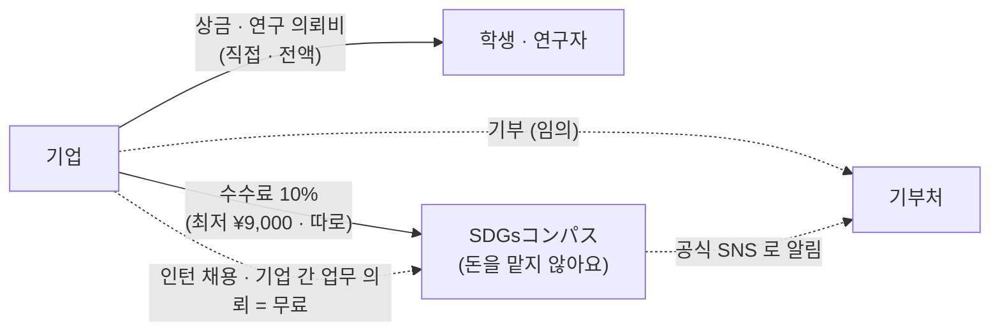

# 수수료와 돈의 흐름 — 직접 지급 모델 (2026-11-08)

> 이 문서는 서비스 설계 메모예요. **법률·세무 자문이 아니고**, 실제 운영 전에 전문가(변호사·행정서사·세무사)의 확인을 받을 예정이에요(아래 [확인할 것](#전문가에게-확인할-것)).
> 데모 앱은 금액 계산과 기록만 보여 주고 **실제 결제·송금·청구는 하지 않아요.** 회사·사람·금액은 모두 가상이에요.

## 한 줄 요약

기업이 내는 **상금과 연구 의뢰비의 10%(최저 ¥9,000)** 를 운영 수수료로 **기업에게서 따로** 받아요.
상금·의뢰비는 **기업이 학생·연구자에게 직접 전액** 지급하고, 운영사는 남의 돈을 **맡지 않아요**. **인턴 채용(채택)은 무료**, **기부는 기업이 원할 때만** 따로 해요.

## 사용자 결정 (2026-11-08)

| 주제 | 결정 | 이전 (~2026-11-07) |
| --- | --- | --- |
| 수수료 | 상금·연구 의뢰비의 **10%**, **최저 ¥9,000** — 기업이 상금·의뢰비와 **따로** 내요 | 채택(인턴 참가 결정) 1건 ¥30,000 |
| 받는 사람 | 학생·연구자는 상금·의뢰비를 **전액** 받아요(수수료를 빼지 않아요) | 같음 |
| 인턴 채용 | **무료** (성과 보수를 받지 않아요) | ¥30,000 의 대상 |
| 기부 | 기업이 **원할 때만** 더해요. 운영사는 공식 SNS 로 알리기만 해요 | ¥30,000 의 50% 가 기업 이름의 기부(수령 대행) |
| 돈의 흐름 | 상금·의뢰비는 기업 → 학생·연구자 **직접**. 운영사는 **맡지 않아요** | 상금을 운영사에 예치 → 학생의 リワード残高 → 출금 (第二種資金移動業 등록 후) |

요율과 최저액은 **1건을 운영하는 원가**(과제·연구 의뢰 1건의 작업 시간 × 시급 + 시스템 비용 + 예비)를 평균 상금·평균 의뢰비로 나눈 값에서 정했어요.
계산표와 숫자의 근거는 사업계획 쪽 자료에 있고, 이 레포에는 결과(10%, ¥9,000)만 둬요.
원가를 실증에서 다시 재면(1건의 작업 시간을 기록) 요율과 최저액도 다시 정해요.

## 기업이 돈을 내는 때

| 때 | 상대에게 (직접 · 전액) | 운영사에 (수수료) |
| --- | --- | --- |
| 과제를 낼 때 | — (상금을 **걸기만** 해요 · `promised`) | — |
| 최우수상을 정할 때 | 상금 → 최우수상 팀 | 상금의 10% (최저 ¥9,000) |
| 학생을 인턴으로 채용(채택)할 때 | — | **무료** |
| 연구 성과를 확인해 완료할 때 | 의뢰비 → 연구자 | 의뢰비의 10% (최저 ¥9,000) |
| 신뢰를 쌓은 기업끼리 업무를 의뢰할 때 | 의뢰비 → 상대 기업 | **무료** (신뢰 기업의 특전) |
| (원할 때) 기부를 더할 때 | 기부금 → 기부처 | — (공식 SNS 로 알려요) |

## 앱에서

| 어디 | 무엇 | 코드 |
| --- | --- | --- |
| 기업 대시보드 「お支払い（手数料）」 | 규칙 · 무료인 것 · 대상 건수 · 상금·의뢰비(직접 지급) 합계 · 수수료 합계 · 거래별 표 | `selectors.ts` 의 `selectFees` ← `fees.ts` 의 `feeItems` |
| 기업 대시보드 「賞金のお支払い」 | 표창 전 · 지급한 상금, 과제별 상태(表彰待ち · 支払い済み · 最優秀賞なし)와 수수료 | `walletView.ts` 의 `selectPrizePayments` |
| 응모자 화면 | 고른 과제의 상금 안내(직접 지급 · 수수료), 채택은 무료라는 안내 | `prizeNotice` · `review.feeNote` |
| 새 과제 · 새 연구 의뢰 | 상금·의뢰비 입력 옆에 「직접 전액 · 수수료 10%(최저 ¥9,000)는 따로」 | `prize.newNote` · `research.new.feeHint` |
| 연구 의뢰 상세(연구자) | 거래 조건의 「運営手数料」: 금액(의뢰비의 10%) · 기업이 따로 낸다 · 의뢰비는 전액 | `research.platformFeeValue` |
| 학생 「受け取った賞金」(`/wallet/`) | 받은 상금(기업이 직접)과 운영사 특별상의 **기록**. 잔액·출금·본인 확인은 없어요 | `walletView.ts` 의 `selectWallet` |

규칙(순수 함수): `packages/core/src/fees.ts` (`platformFeeFor` = max(¥9,000, 금액 × 10% 엔 미만 버림), `feeItems`, `summarizeFees`), 상금은 `wallet.ts` (`promisePrize` · `payPrize`).
데모 상태: `DemoState.prizePayments`(과제마다 건 상금과 지급), `DemoState.wallet.entries`(학생이 받은 기록), `DemoState.matches`(채택 — 돈 없음).
예전에 저장된 상태(리워드 잔액 · 상금 예치 · 채택 수수료)는 불러올 때 새 모양으로 이어 써요(`packages/data/src/storage.ts` 의 `upgradeMoney`).

## 운영사 특별상 (운영 환원)

흑자가 된 뒤 각 기 말에 **운전자금 3개월분**(그 기 경비 + 매출원가의 3/12)을 남기고, **그 기 경상이익 중 남는 금액 전부**를 미리 공개한 기준(수상·제출 실적 — 작업 시간·양이 아니에요)으로
**운영사가 상금을 내는 학생 특별상**으로 드려요(2026-11-01 결정의 환원 규칙은 그대로, 받는 방법만 리워드 잔액에서 특별상으로). 계산은 `wallet.ts` 의 `returnPoolYen`.

## 남은 일

- **DB 를 새 모델로**: `db/schema.sql` 은 아직 이전 설계예요 — `matches` 의 수수료·기부 생성 열(¥30,000 · 50%), `donations`, #25 의 `wallet_*` · `prize_deposits` · `withdrawal_requests`.
  앱↔DB 대조(`scripts/gen-db-reference.ts`)는 그동안 이전 규칙(`fees.ts` · `wallet.ts` 의 레거시 상수, 생성기 안의 레거시 열거형)으로 DB 를 확인해요.
  옮길 때: `prize_payments`(promised · paid · noWinner), 연구 의뢰 표, 수수료 표(또는 생성 열)를 만들고, 레거시 상수·열거형을 지워요.
- **운영자 수지 시뮬레이션**(`adminFinance.ts`): 아직 이전 모델(매칭 수 × ¥30,000 × 50%)의 입력이에요. 새 입력(기업 수 × 연간 상금 과제 수 × 평균 상금 × 10% + 연구 의뢰 …)으로 바꿔요.
- 실증에서 1건의 작업 시간을 기록해 원가를 다시 재고, 요율·최저액을 확인해요.

## 전문가에게 확인할 것

법률 자문이 아니라, 운영 전에 확인받을 목록이에요.

- **자금 이동**(資金決済法): 상금·의뢰비를 운영사가 맡지 않고 기업이 직접 지급하는 설계가 자금이동업·수납 대행에 해당하지 않는지. 청구·결제 대행 서비스를 쓰게 되면 그 계약 형태도.
- **수수료의 표시와 청구**: 기업에게 따로 청구하는 수수료의 표시(세금 포함 여부), 청구 시점(표창·완료 때), 미수금 처리.
- **직업소개**(職業安定法): 인턴 채용을 무료로 연결하는 것이 직업소개에 해당하는지(유료가 아니어도 허가·신고가 필요한 경우), 인턴의 형태(유급·무급).
- **상금의 세금**: 학생이 받는 상금(일시소득 등)과 기업의 처리, 운영사 특별상의 처리. 유학생은 자격외활동허가 범위.
- **기부**: 기업이 기부처에 직접 하는 기부를 운영사가 공식 SNS 로 알릴 때의 표시(기업·기부처의 동의).
