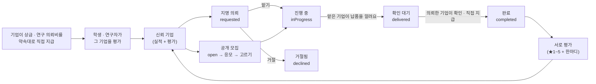

# 기업 네트워크 — 신뢰를 쌓은 기업끼리의 업무 의뢰 (웹 데모, 2026-11-08)

> 이 문서는 서비스 설계 메모예요. **법률·세무 자문이 아니고**, 실제 운영 전에 전문가의 확인을 받을 예정이에요(아래 [확인할 것](#전문가에게-확인할-것)).
> 데모 앱은 화면과 규칙만 보여 주고 **실제 송금·계약은 하지 않아요.** 회사·사람·금액·평가는 모두 가상이에요.

## 한 줄 요약

이 앱에서 **약속대로 지급하고**(상금 · 연구 의뢰비) **거래 상대에게 평가받은** 기업은 **신뢰 기업**이 돼요.
신뢰 기업끼리는 시제품 · 제조 · 물류 같은 일을 **지명**하거나 **공개 모집**으로 서로 의뢰할 수 있고, **수수료는 없어요**(신뢰 기업의 특전).
아이디어를 실현하는 흐름의 마지막 단계(⑤ 제조·판로)를 앱 안에서 잇는 기능이에요. 은행의 비즈니스 매칭과 함께 쓸 수 있고, 이 앱에서는 **지급 실적과 거래 상대의 평가를 보고 상대를 직접 고를 수 있어요.**

## 사용자 결정 (2026-11-08)

| 주제 | 결정 |
| --- | --- |
| 수수료 | **무료**(신뢰 기업의 특전). 운영사의 수입은 그대로 상금·연구 의뢰비의 10%(최저 ¥9,000)예요 → [fees.md](fees.md) |
| 신뢰 기업 | **실적 + 상대 평가** — 앱 안에서 약속대로 지급한 거래가 있고, 거래 상대(학생 · 연구자 · 기업)의 평가가 좋아야 해요 |
| 의뢰 방식 | **둘 다** — 한 곳을 골라 맡기는 **지명**, 신뢰 기업에게서 응모를 받는 **공개 모집** |
| 범위 | 웹 데모만(모바일 앱 화면은 없어요 — 데이터 모양은 같이 써요) |

## 신뢰 기업의 조건 (데모 규칙)

세 가지를 모두 채우면 신뢰 기업이에요. 기준값은 데모용이고, 실제 거래 데이터를 보고 다시 정해요. 상수는 `packages/core/src/network.ts` 의 `TRUST_RULE` · `LATE_AFTER_DAYS` 예요.

1. **약속대로 지급한 거래 1건 이상** — 최우수상 팀에 지급한 상금, 성과를 확인하고 지급한 연구 의뢰, 끝난 기업 간 의뢰(의뢰했거나 맡았거나)
2. **받은 평가 1건 이상, 평균 ★3.5 이상** — 상금을 받은 학생 · 연구자 · 기업 간 거래 상대가 남긴 평가
3. **지급 지연이 없어요** — 우리가 의뢰한 연구 · 업무의 성과(납품)가 온 지 **14일**이 지났는데 아직 확인 · 지급하지 않은 것이 있으면 빠져요

조건을 채우지 못한 기업은 목록 아래 「これから信頼を積む企業」에 **무엇이 모자란지**와 함께 보여요. 의뢰를 내거나 받을 수는 없어요.

## 흐름

- 의뢰비는 완료할 때 **의뢰한 기업이 맡은 기업에 직접** 지급해요(데모는 기록만). 운영사는 돈을 맡지 않아요.
- 공개 모집에 응모할 수 있는 것도 신뢰 기업뿐이고, 한 모집에 한 번, 한 줄(120자)로 응모해요. 의뢰한 기업은 응모한 기업의 **실적과 평가를 보고** 한 곳을 골라요.
- 의뢰 내용 · 응모 · 납품 한마디 · 평가에는 메일 주소 · 전화번호를 쓸 수 없어요(연락은 앱 안에서).

## 상호 평가

| 거래 | 누가 → 누구 | 어디서 |
| --- | --- | --- |
| 상금 | 받은 학생 → 지급한 기업 | 학생 「受け取った賞金」(`/wallet/`) — 받은 기록마다 |
| 연구 의뢰 | 연구자 → 기업, 기업 → 연구자 | 연구자의 의뢰 상세(`/lab/request/`) · 기업의 연구 의뢰 목록(`/b2b/research/`) |
| 기업 간 의뢰 | 의뢰한 기업 ↔ 맡은 기업 | 의뢰 상세(`/b2b/network/request/`) |

- 끝난 거래(지급한 상금 · 완료한 의뢰)의 상대만, **한 거래에 한 번** 평가해요. 별 1~5(정수) + 한마디(80자).
- 기업이 받은 평가는 기업 프로필에 공개되고 신뢰 기업 판단에 쓰여요. 연구자가 받은 평가는 그 의뢰 상세에서 연구자에게 보여요(공개 프로필은 없어요). 학생은 평가받지 않아요.
- 데모에서는 고치거나 지울 수 없어요(아래 남은 일).

## 화면과 주소

| 화면 | 주소 | 코드 |
| --- | --- | --- |
| 기업 네트워크(우리 회사의 신뢰 실적 · 기업 찾기 · 공개 모집 · 주고받기) | `/b2b/network/?tab=open\|mine&category=…&sort=deals&q=…` | `NetworkHomeScreen.tsx` |
| 기업 프로필(실적 · 할 수 있는 일 · 받은 평가) | `/b2b/network/company/?id=…` | `NetworkCompanyScreen.tsx` |
| 의뢰 내기 | `/b2b/network/new/?to=…`(지명) · `?mode=open`(공개 모집) | `NewWorkScreen.tsx` |
| 의뢰 상세(진행 단계 · 조건 · 응모 · 할 일 · 평가) | `/b2b/network/request/?id=…` | `WorkRequestScreen.tsx` |

- 기업의 하단 탭(PC 폭은 왼쪽 메뉴) 「依頼」 = 연구 의뢰 + 기업 네트워크. 두 목록 화면 맨 위의 칩으로 오가요.
- 대시보드에 한 줄(받은 의뢰 · 낸 의뢰 · 공개 모집, 할 일이 있으면 강조).
- 화면 모델은 `packages/core/src/networkView.ts`, 규칙은 `network.ts`, 문구는 `messages/network.ts`(ja · ko).

## 데이터 (데모 상태)

- `Company.offers`(할 수 있는 일: 시제품 · 제조·가공 · 소재·자재 · 물류·보관 · 판로·판매 · 디자인·홍보 · 조사·분석 · 그 밖) · `offerNote`
- `WorkRequest`(지명/공개 모집, 의뢰한 기업 · 맡은 기업, 분야, 제목 · 내용, 의뢰비, 납기, 상태, 응모, 납품 한마디)
- `Rating`(거래 종류 · 거래 id, 누가(학생 · 연구자 · 기업) → 누구(기업 · 연구자), 별, 한마디)
- 기업 네트워크가 생기기 전에 저장된 데모 상태는 샘플(의뢰 · 평가 · 할 수 있는 일 · 샘플 회사)로 채워서 이어 써요(`packages/data/src/storage.ts`).

## 남은 일

- **DB 설계**: `work_requests` · `work_applications` · `ratings` (돈 표를 직접 지급 모델로 옮기는 일과 함께 — [fees.md](fees.md) 「남은 일」)
- 평가의 이의 신청 · 운영자의 숨기기, 서로 높은 평가를 주고받는 악용 막기
- 의뢰 조건(납기 · 지급 기한 · 검수)을 서면으로 남기는 화면, 취소 · 분쟁 처리
- 모바일 앱 화면
- 신뢰 기준값을 실제 데이터로 다시 정하기

## 전문가에게 확인할 것

- **기업 간 위탁 거래의 규칙**: 맡기는 쪽 · 맡는 쪽의 규모에 따라 取適法(中小受託取引適正化法, 구 下請法)이 걸릴 수 있어요. 발주 조건을 서면으로 밝히는 일 · 지급 기한 등을 앱이 어디까지 도와야 하는지. (앱의 「지급 지연 14일」은 신뢰 판단용 기준이고 법정 기한이 아니에요.) 개인 사업자에게 맡기는 경우는 フリーランス法도.
- **평가의 공개**: 사실과 다른 평가로 인한 명예 · 신용 훼손 위험, 삭제 요청 대응(情報流通プラットフォーム対処法 등).
- **「信頼企業」 표시**: 운영사가 품질 · 이행을 보증하는 것처럼 보이지 않도록 하는 표현과 안내.
- **중개**: 수수료가 없더라도 기업 간 거래를 연결하는 것에 필요한 등록 · 약관이 있는지, 운영사가 돈을 맡지 않는 구조가 유지되는지.
- **가입 심사**: 반사회적 세력 확인 등 기업 계정을 받을 때의 확인 절차.
