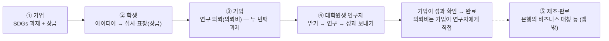

# 연구 의뢰 — 연구자(대학원생) 역할 설계 (웹 데모)

> 이 문서는 서비스 설계 메모예요. **법률·세무 자문이 아니고**, 실제 운영 전에 전문가의 확인을 받을 예정이에요(아래 [확인할 것](#전문가에게-확인할-것)).
> 데모 앱은 화면과 규칙만 보여 주고 **실제 송금·계약·파일 전송은 하지 않아요.** 회사·사람·금액은 모두 가상이에요.

## 한 줄 요약

기업이 SDGs 과제와 상금을 내고, 학생 아이디어를 표창·채택하면, 그 아이디어를 **실현하기 위한 연구를 대학원생에게 「연구 의뢰」(두 번째 과제)로 맡겨요.**
대학원생 연구자는 의뢰를 맡아 연구하고 성과(보고서·데이터)를 기업에 보내고, 기업이 확인하면 **의뢰비를 기업에게서 직접** 받아요.
공장·판로는 은행의 비즈니스 매칭 등이 맡아서 **앱에서는 다루지 않아요.**

## 사용자 결정 (2026-11-07)

| 주제 | 결정 |
| --- | --- |
| 범위 | **웹 데모만.** 모바일 앱은 학생·기업 두 역할 그대로(같은 데이터 모양을 쓰지만 연구자 화면은 없어요). |
| 연구자 | **세 번째 역할** `researcher` — 역할 선택에 「研究者（大学院生）」, 화면은 `/lab/*`. |
| 운영 수수료 | **대학원생 설문 뒤에 정해요.** 화면에는 금액 없이 「予定」/「예정」으로만 보여요(코드에 금액이 없어요). |
| 인턴 채용 수수료 | 지금의 **1건 ¥30,000(절반은 기업 명의의 기부)은 그대로** 두고, 연구 의뢰를 더해요. |
| 제조·판로 | 은행의 비즈니스 매칭 등이 맡아요 — 앱 밖. |

## 흐름

기업이 돈을 내는 때는 세 번이에요(기업 화면 「研究依頼」 맨 위에 보여요).

1. 과제를 낼 때: 상금(최우수상 팀에게)
2. 학생을 인턴으로 채용할 때: ¥30,000(절반은 기업 명의의 기부)
3. 연구 성과를 확인할 때: 의뢰비(연구자에게 직접) — 운영 수수료는 예정

## 상태

| 상태 | 화면 이름 | 누가 바꾸나요 | 조건 |
| --- | --- | --- | --- |
| `open` | 募集中 / 모집 중 | 기업이 게재 | 출발점은 **우리 회사 과제에서 표창(awarded)·채택(adopted)된 기획서** |
| `inProgress` | 研究中 / 연구 중 | 연구자가 「この依頼を引き受ける」 | 모집 중이고 기한 전. 데모는 누르면 바로 담당(실서비스에서 정하는 방법은 설문 뒤에) |
| `delivered` | 確認待ち / 확인 대기 | 맡은 연구자가 성과(요약 + 파일)를 보냄 | 내가 맡은 연구 중 의뢰만 |
| `completed` | 完了 / 완료 | 의뢰한 기업이 「成果を確認して完了にする」 | 우리 회사 의뢰 · 확인 대기만. 의뢰비 지급을 기록해요(데모) |

규칙은 `packages/core/src/research.ts`, 화면용 데이터는 `researchView.ts`, 문구는 `messages/research.ts`, 샘플은 `packages/data/src/seed.ts`(연구자 1명 · 의뢰 5건)에 있어요.

## 화면과 주소

| 역할 | 주소 | 내용 |
| --- | --- | --- |
| 연구자 | `/lab/?field=` | 프로필 한 줄 · 흐름(④ 강조) · 분야 칩 · 지금 맡을 수 있는 의뢰(새로 올라온 순) |
| 연구자 | `/lab/request/?id=` | 진행 단계 · 연구해 주었으면 하는 것 · 성과물 · 출발점 아이디어 · **거래 조건**(의뢰비 · 기한 · 지급 · 운영 수수료 예정) · 맡기 전에 확인할 것 · 맡기 / 성과 보내기 |
| 연구자 | `/lab/mine/` | 연구 중 · 확인 대기 · 완료 · 받은 의뢰비 |
| 연구자 | `/lab/settings/` | 언어 · 역할 바꾸기 · 연구자 프로필 · 데모 초기화 |
| 기업 | `/b2b/research/?posted=` | 흐름(③ 강조) · 돈을 내는 때 · 숫자 · 우리 회사 의뢰(확인 대기 먼저) · 완료 |
| 기업 | `/b2b/research/new/?proposal=` | 아이디어 고르기 · 제목(60자) · 연구해 주었으면 하는 것(400자) · 성과물(100자) · 분야(최대 3) · 의뢰비(¥10,000~¥1,000,000, 데모의 입력 범위) · 기한(7~180일) |
| 기업 | `/b2b/applicants/` | 표창·채택한 카드에 「研究を依頼する」와 「研究依頼 n件」 |
| 기업 | `/b2b/` | 과제 관리 아래에 연구 의뢰 한 줄(모집 중 · 연구 중 · 확인 대기) |

머리글의 역할 칩을 누르면 역할 선택(학생 · 기업 · 연구자)으로 가요. 연구자는 `/lab/*` 만, 기업은 `/b2b/*` 만, 학생은 학생 화면만 열려요(`apps/web/src/lib/routes.ts` 의 `guardRedirect`).

## 돈과 파일

- **의뢰비는 운영사가 맡지 않아요.** 기업이 성과를 확인한 뒤 연구자에게 직접 지급하고, 앱은 지급을 기록만 해요(데모). 운영사가 돈을 맡거나 대신 보내는 방식(에스크로 등)은 설문과 전문가 확인 뒤에 다시 정해요.
- 연락처(이메일·전화번호)는 의뢰 글에 쓸 수 없어요(SNS 글과 같은 검출 규칙).
- 성과 파일은 PDF · PPTX · DOCX · XLSX · CSV · ZIP, 50MB 까지. 데모는 **파일 이름과 크기만 읽고** 내용은 읽거나 보내지 않아요. 파일 지문은 의뢰 id · 파일 이름 · 크기 · 요약의 SHA-256(실서비스는 파일 내용의 해시).
- DB 표는 아직 없어요. 운영 수수료와 의뢰를 받는 방법이 정해지면 `db/schema.sql` 에 더해요.

## 대학원생 설문으로 정할 것

- 운영 수수료: 금액 · 누가 내는지(기업 / 연구자)
- 의뢰를 받는 방법: 먼저 맡기 · 기업이 응모자 중에서 고르기 · 연구실(지도교원)을 거치기
- 받아들일 만한 의뢰비와 기간, 성과물의 모양(보고서 · 데이터 · 시험)
- 대학·연구실 규칙(학외 업무 · 설비 사용)과 지도교원 상의가 필요한 경우
- 성과의 권리와 논문 등으로 공개할 수 있는 범위(비밀 유지 약속과 학위 논문의 관계)

## 전문가에게 확인할 것

법률 자문이 아니라, 운영 전에 확인받을 목록이에요.

- **프리랜서 거래 규칙**(フリーランス・事業者間取引適正化等法, 2024-11 시행): 개인에게 업무를 맡길 때 거래 조건(내용 · 보수 · 지급일 등)을 명시하는 의무와 지급 기일. 앱은 맡기 전에 조건을 화면에 보여 주지만, 계약 서면을 대신하지는 않아요. → [공정거래위원회 특설 사이트](https://www.jftc.go.jp/freelancelaw_2024/)
- **직업소개**(職業安定法): 연구 의뢰는 고용이 아닌 업무 위탁의 연결이에요. 고용(아르바이트 등)이 되면 유료 직업소개에 해당할 수 있어요.
- **자금 이동**(資金決済法): 운영사가 의뢰비를 맡거나 대신 보내면 자금이동업 등록이나 수납 대행 계약이 필요한지.
- **지식재산과 대학 규정**: 대학 설비·지도 아래에서 만든 성과의 권리 귀속(직무 발명 규정 등). 큰 연구는 대학의 산학연계 창구(수탁 연구·공동 연구)로 잇는 길도 검토.
- **세금과 체류 자격**: 의뢰비는 소득으로 과세될 수 있어요(확정신고). 유학생은 자격외활동허가 범위를 확인해야 해요.
