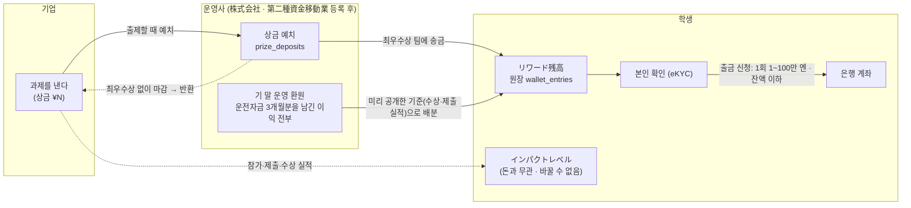

# リワード残高 (보상 잔액) — 기업 상금 · 운영 환원 · 출금 설계 (#25, 데모)

> 이 문서는 서비스 설계와 공개된 1차 자료를 정리한 메모예요. **법률·세무 자문이 아니고**, 실제 운영 전에 전문가(행정서사·변호사·세무사)의 확인을 받을 예정이에요.
> 데모 앱은 화면과 규칙만 보여 주고 **실제 송금·결제·은행 연동·본인 확인(eKYC)은 하지 않아요.** 금액·회사·사람은 모두 가상이에요.

## 한 줄 요약

학생은 **「リワード残高」(보상 잔액, 엔 단위)** 로 ① 기업이 과제에 건 **상금**과 ② 운영사의 **운영 환원**을 받고, **본인 확인 뒤 은행 계좌로 출금**해요(1회 100만 엔 이하).
이 기능은 운영사(株式会社)가 **第二種資金移動業 등록**을 받은 뒤에 제공해요. 등록 전에는 운영사가 돈을 다루지 않고, 상금은 기업이 수상자에게 직접 지급해요.
실적(참가·제출·수상)은 **임팩트 레벨**로만 보여 주고, 레벨은 돈과 관계없어요(바꿀 수 없어요).

## 사용자 결정 (2026-11-01)

| 주제 | 결정 |
| --- | --- |
| 실적 표시 | **레벨 + 다음 레벨까지 진행률(%)**. 화면의 포인트 숫자는 숨겨요(#24). 레벨은 돈과 무관하고 바꿀 수 없어요. |
| 보상 방식 | **처음부터 등록형** — 운영사가 第二種資金移動業 등록을 받은 뒤 ① 상금(과제를 낼 때 운영사에 예치) ② 운영 환원을 リワード残高로 보내고, 학생은 본인 확인 뒤 출금(1회 100만 엔 이하). **등록 전에는 제공하지 않아요.** |
| 운영 환원 | 각 기 말에 **운전자금 3개월분**(그 기 경비 + 매출원가의 3/12)을 남기고, **그 기 경상이익 중 남는 금액 전부**를 학생에게 환원. 배분은 **미리 공개한 기준**(그 기의 수상·제출 등 실적 — 작업 시간·양에 비례하지 않게). |

## 구조

- 잔액은 **살 수 없고(충전 없음)**, **남에게 넘길 수 없고**, **이자가 붙지 않아요.** 원장에는 입금(상금·환원)과 출금만 있어요.
- 상금은 과제의 **최우수상 1팀**(그 팀의 제출자 = 데모의 대표)에 가요. 한 번 보낸 상금은 되돌리지 않아요. 우수상·특별상에는 이 데모에서 상금을 붙이지 않아요(상별 상금은 앞으로 검토).
- 최우수상을 정하지 않고 과제가 끝나면 맡긴 상금은 기업에 돌려줘요(「賞金の返金（企業へ）」).
- 사업 계획의 시산에서는 **처음 몇 기 동안 기말 자금이 운전자금 3개월분에 못 미쳐 환원이 없을 수 있어요.** 앱·문서는 이것을 숨기지 않고, 운영자 화면의 수지 시뮬레이션(#26, [docs/admin.md](admin.md))이 같은 규칙으로 "몇 기부터 환원되는지"를 보여 줘요. 공개 저장소에는 실제 계획의 숫자를 싣지 않아요.

## 데모에서 볼 수 있는 것

| 누가 | 어디서 | 무엇을 |
| --- | --- | --- |
| 학생 | Impact 화면의 「リワード残高」 카드 → **`/wallet/`**(웹) · **`/wallet`**(앱) | 잔액 · 입출금 내역(「企業の賞金」「運営からの還元」「出金」) · 본인 확인 데모 버튼 「本人確認を完了する（デモ）」 · 출금 신청 폼(금액 검사) · 완료 안내 「申請を受け付けました（デモ：実際の送金は行いません）」 · 고지 ①~④ |
| 기업 | 새 과제 출제 | 상금 입력 옆 안내 「賞金は当社に預け入れ、受賞者のリワード残高へ送金されます（資金移動業の登録後）」 |
| 기업 | 응모자·심사 | 과제를 고르면 상금 상태 안내. **최우수상을 정하면 맡긴 상금이 수상 팀으로 송금**(데모) — 내 기획서(학생 Mina)가 최우수상이면 학생 화면의 잔액이 늘어요 |
| 기업 | 대시보드 | 「賞金の預け入れ（デモ）」: 預け入れ中 · 送金済み · 賞金の返金（企業へ）의 합계와 과제별 상태 |

샘플(가상): 학생 Mina 는 수상 실적(「プラスチックごみ削減ハッカソン」 優秀賞)에 이어진 기업 상금 ¥30,000 과 「運営からの還元（サンプル）」 ¥1,500 을 받아 잔액 ¥31,500, 본인 확인 전, 출금 0건. 상금이 걸린 샘플 과제는 모두 예치 중이고, 끝난 과제 2건은 송금·반환 예시예요.

화면에 늘 보이는 고지(ja · ko 같은 뜻):

1. 「リワード残高は、当社が第二種資金移動業の登録を受けた後に提供する予定の機能です（デモ）。」
2. 「出金には本人確認が必要です。1回100万円まで。」
3. 「賞金・還元は所得として課税される場合があります（確定申告が必要なことがあります）。留学生の方は、受け取る前に在留資格（資格外活動許可）を確認してください。」
4. 「インパクトレベルは換金できません。リワード残高とは別のものです。」

## 규칙과 코드 · DB

| 규칙 | 앱 (`packages/core`) | DB (`db/schema.sql`, 시험 `db/tests/07_wallet.sql`) |
| --- | --- | --- |
| 잔액 = 입금(상금·환원) − 출금(신청 중 포함) | `wallet.ts` `walletTotals` | 뷰 `wallet_balances` |
| 출금: 본인 확인 완료 → 1엔 이상 정수 → **1회 1,000,000엔 이하** → 잔액 이하 | `validateWithdrawal` · `WITHDRAWAL_MAX_YEN` | `withdrawal_requests` CHECK + 가드 트리거(계정 행을 잠그고 잔액 확인) |
| 상금 예치: 과제당 1건, 금액 = 그 과제의 상금 | `depositFor` (출제할 때) | `prize_deposits` (복합 FK → `challenge_rewards`, `challenges`) |
| 최우수상이면 송금, 한 번 보낸 돈은 되돌리지 않음 | `settlePrize` · `PRIZE_AWARD = "grand"` | `awards` 에 grand 가 들어오면 트리거가 송금 → 원장 입금. 복합 FK 로 같은 과제의 최우수상에만 |
| 최우수상 없이 마감 → 기업에 반환 | (샘플만) | `prize_deposits` 가드: closed 이고 grand 가 없을 때만 refunded |
| 운영 환원 총액 = max(0, min(경상이익, 기말 자금 − 운전자금 N개월분)), N = 3 | `returnPoolYen` · `RETURN_RESERVE_MONTHS` | `reward_return_rounds` 의 생성 열 `reserve_yen` · `total_yen` |
| 배분 합계 = 환원 총액, 기준은 그 기가 시작하기 전에 공개 | — | `reward_return_allocations` + 지연 제약 트리거, CHECK `criteria_published_on <= period_start` |
| 원장은 고칠 수 없음 | — | `wallet_entries` (수정·삭제 금지 트리거, 출처 하나에만 연결) |

앱과 DB 가 같은 값을 쓰는지는 `db/tests/04_parity.sql` 의 9번(출금 상한·하한, 최우수상, 운전자금 개월 수, 환원 계산 12건)이 `scripts/gen-db-reference.ts` 가 만든 정답표로 맞춰 봐요. ERD 는 README 의 「⑨ リワード残高 · 상금 예치 · 운영 환원」.

## 법적 근거 요약 (2026-10-31, 1차 자료 기준 — 법률 자문 아님)

- **資金移動業 등록이 필요해요.** 기업의 돈을 받아 개인 학생에게 넘기는 것은 為替取引에 해당할 수 있어서 資金決済法(2条の2 등)·金融庁 事務ガイドライン에 따른 資金移動業 등록이 필요해요. 등록은 **株式会社**만 할 수 있고, 아직 보내지 않은 돈(미송금 자금)은 **100% 履行保証金**(供託·保全契約·信託)으로 지켜야 해요. AML/CFT 와 **本人確認(eKYC)** 체계, **登録免許税 15만 엔**, 표준 처리 기간 2개월(사전 상담 별도).
- **第二種 = 1회 100만 엔 이하** 송금이에요. 그래서 출금 1회 상한을 100만 엔으로 두었어요.
- 학생은 잔액을 **살 수 없고(충전 없음)**, 남에게 **넘길 수 없어요.** 잔액에 이자를 붙이지 않아요.
- **景品表示法**: 구매를 조건으로 하지 않는 공모전 상금은 オープン懸賞으로 보아 상한이 없어요(문제가 적다고 봐요).
- **세금**: 상금은 一時所得(특별공제 50만 엔), 정기적인 환원은 雑所得이 될 수 있어요 → 앱에 "확정신고가 필요할 수 있음" 안내. 지급하는 쪽의 원천징수·支払調書 의무는 별도로 검토해요.
- **유학생**: 한 번뿐인 공모전 상금은 허가가 필요 없을 수 있지만, **정기적인 환원은 '보수'로 보아 資格外活動許可가 필요할 수 있어요** → 앱에 "受け取る前に在留資格を確認" 안내.
- **노동**: 보상이 작업 시간·양에 비례하면 労働者性(근로자성) 위험이 있어요 → 배분 기준은 **수상·제출 같은 실적**으로, 시간·양에 비례하지 않게.

### 출처 (모두 2026-10-31 확인 — 제목은 내용을 짧게 적은 것이고, 원문은 링크를 봐 주세요)

- 金融庁 — 資金移動業 관련 자료 (PDF): https://www.fsa.go.jp/menkyo/menkyoj/shikin_idou.pdf
- 金融庁 — 2025-12-16 공표 자료 (PDF): https://www.fsa.go.jp/news/r7/sonota/20251216/33.pdf
- 関東財務局 — 資金移動業 등록 안내: https://lfb.mof.go.jp/kantou/kinyuu/pagekt_cnt_20250516001sikinidou.html
- 消費者庁 — 景品規制: https://www.caa.go.jp/policies/policy/representation/fair_labeling/premium_regulation/
- 国税庁 タックスアンサー No.1490 (一時所得): https://www.nta.go.jp/taxes/shiraberu/taxanswer/shotoku/1490.htm
- 国税庁 タックスアンサー No.7431 (法定調書): https://www.nta.go.jp/taxes/shiraberu/taxanswer/hotei/7431.htm
- 出入国在留管理庁 — 資格外活動許可: https://www.moj.go.jp/isa/applications/procedures/nyuukokukanri07_00045.html
- 公正取引委員会 — フリーランス法 Q&A: https://www.jftc.go.jp/fllaw_limited/fllaw_qa.html
- 経済産業省 — グレーゾーン解消制度의 회답 (2016-07-05, PDF): https://www.meti.go.jp/policy/jigyou_saisei/kyousouryoku_kyouka/shinjigyo-kaitakuseidosuishin/press/160705_press.pdf

## 하지 않는 것 (데모의 범위 밖)

- 실제 송금·결제·은행 연동, 실제 본인 확인(eKYC)·계좌 등록 — 데모는 버튼과 상태만 바꿔요.
- **등록 전의 운영** — 등록 전에는 운영사가 상금·환원을 맡거나 보내지 않아요(상금은 기업이 수상자에게 직접 지급).
- 팀 상금의 나눔 — 데모는 제출자(대표)에게 보내요. 실서비스에서는 팀 안의 나눔 비율을 미리 정하는 방식을 검토해요.
- 상별(최우수상 외) 상금, 원천징수·支払調書 계산, 출금 실패·취소(반려) 처리, 1인당 잔액 상한 관리.
- 실제 운영 환원 회차 — 샘플 내역 「運営からの還元（サンプル）」 은 화면 예시예요. 환원은 기 말에 이익과 자금이 남을 때만 생겨요.

## 전문가에게 확인할 질문

1. 기업이 맡긴 상금을 수상 학생의 잔액으로 보내는 구조가 為替取引(資金移動業)에 해당하는지, 収納代行 등 다른 정리가 가능한지.
2. 운영사가 자기 이익을 학생에게 나누는 「運営からの還元」을 잔액으로 보내는 것이 資金移動業의 범위 안에서 정리되는지(前払式支払手段 등 다른 규제와의 관계 포함).
3. 第二種의 1회 100만 엔 상한 외에, 한 사람의 잔액이 오래 쌓이는 것(滞留)에 대해 필요한 관리가 있는지.
4. 本人確認(取引時確認)을 입금 전(계정을 열 때)에 해야 하는지, 출금 전에 해도 되는지.
5. 상금(一時所得)과 정기 환원(雑所得 등)에 대한 지급자 측의 원천징수·支払調書 의무와, 학생 안내 문구가 충분한지.
6. 유학생이 정기 환원을 받을 때 資格外活動許可가 필요한지, 앱에서 받기 전에 확인하는 절차가 필요한지.
7. 배분 기준(수상·제출 실적)이 労働者性·フリーランス法 관점에서 문제가 없는지, 기준 공개 시점(기가 시작하기 전)이 적절한지.
8. 履行保証金(供託·保全契約·信託) 중 초기 규모에 맞는 방법과, 등록까지 필요한 기간·비용의 현실적인 범위.
