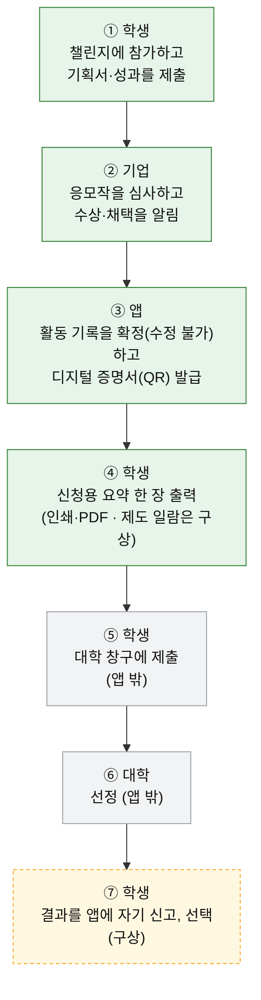

# 학생(개인회원)의 메리트 — 활동 증명서와 대학 활동 장려 제도

"학생이 이 앱을 쓰면 무엇을 얻나요? 장학금을 받을 수 있나요?"에 **확인된 사실만으로** 답하는 문서예요.
지금 시제품에 **있는 것**과 **구상(아직 없는 것)**을 나누어 적고, 장학금·활동 장려 제도를 조사한 결과(2026-10-30, 공개 페이지 기준)와 앱이 맡을 수 있는 범위를 밝혀요.
제도의 금액·모집 시기는 바뀔 수 있으니 실제로 신청할 때는 각 대학·기관의 최신 안내를 확인하세요. 법률·세무 자문이 아니에요.

## 1. 결론

- 학생은 **무료**로 쓰고, 활동이 **기록과 디지털 증명서(QR)**로 남아요. 증명서는 앱 안에서 위·변조 여부를 확인할 수 있어요.
- **SDGs 활동만으로 받는 전국 공통 장학금은 이번 조사에서 확인하지 못했어요.** 과거에 있던 JASSO 優秀学生顕彰(社会貢献 분야 포함)도 「令和元年度をもって廃止」예요[5].
- **가장 가까운 실제 제도는 대학이 운영하는 활동 장려 제도**이고, 그 대학 학생에게만 해당해요. 예를 들어 専修大学 自己啓発奨学生은 규정에 「自治・社会活動」을 명시하고, 개인 최대 20万円·단체 최대 50万円(선정 시 일시금)이에요[1][2].
- 그래서 앱이 하려는 것은 **장학금을 주는 일이 아니라, 신청할 때 쓸 수 있는 활동 기록과 증명서를 갖춰 두는 일**이에요. 시제품에는 기간을 골라 활동·증명서를 **A4 한 장으로 정리하는 신청용 요약 화면**이 있어요(§2). 대학이 앱의 증명서·요약을 증빙으로 **인정하는지는 아직 확인하지 않았어요**(§6).

## 2. 학생이 얻는 것 — 지금 있는 것과 구상

| 메리트 | 상태 | 어디서 보이나요 |
| --- | --- | --- |
| 학생·개인은 무료로 이용 | **지금** | 학생 화면 전체 |
| 활동 기록 → Impact(레벨 · SDG 레이더 차트 · 배지) | **지금** (시제품에서 동작) | Impact 화면 (F-104·F-401) |
| 디지털 증명서(SHA-256 해시 + QR)와 진위 확인 ✓ / 변조 ✗ | **지금** (앱 안에서만 확인 — 블록체인·외부 검증 서버 없음) | 증명서 화면 `/certificate/?id=…` (F-502) |
| 확정한 활동 기록·증명서는 수정 불가 | **지금** (DB 트리거) | [ERD](../README.md#erd-db-설계) · `db/schema.sql` |
| 수상·참가 실적을 피드에 자랑 글로 공유 | **지금** | [SNS 피드](sns-feed.md) (F-503) |
| 신청용 요약 「申請用のまとめ」(기간을 골라 활동 · SDGs · 증명서 ID·QR · 고지를 A4 한 장으로) | **지금** (시제품: 웹은 인쇄·PDF 저장, 모바일은 글로 공유) | Impact 화면 → 「申請用のまとめを作る」 `/impact/summary/` (#22) |
| 대학·재단 제도 일람(제도 이름 · 마감 · 필요 서류) | **구상** | — |
| 결과를 앱에 자기 신고(포트폴리오에 「申告・未検証」으로 표시) | **구상** | — |
| 기업 상금 · 운영 환원을 「リワード残高」로 받고 본인 확인 뒤 출금 | **데모** (2026-11-01 결정: 운영사가 第二種資金移動業 등록을 받은 뒤 제공. 등록 전에는 상금을 기업이 수상자에게 직접 지급) | Impact → 「リワード残高」 `/wallet/` (#25) · [rewards.md](rewards.md) |

  

## 3. 조사한 제도 (활동이 돈·표창과 이어지는 것)

열람일은 모두 2026-10-30예요. 금액은 대부분 **상한**이며 지급 보장이 아니에요.

| 제도 | 운영 | 금액 | 활동의 쓰임 | 한정 · 시기 | 출처 |
| --- | --- | --- | --- | --- | --- |
| 専修大学 自己啓発奨学生 | 専修大 (学生生活課) | 개인 최대 20万円 / 단체 최대 50万円 (선정 시 일시금) | 「学術、文芸、スポーツ、自治・社会活動等に明確な目的を有し」 우수한 성과를 내고 더 높은 목표를 향하는 개인·단체. 学部長会 검토 → 学長 결정 | 専修大생. 신청 서류·시기는 공개 페이지에서 못 찾음. 규정 갱신 2016-10-18 | [1][2] |
| 専修大学 育友会奨励賞 | 育友会 | 表彰状 + 奨励金 (금액 미공개) | 「学業、スポーツ、社会貢献など創造的な行動と成果」 | 専修大생. 응모·추천 방법 미공개 | [3] |
| 専修大学 SDGsチャレンジプログラム | 専修大 | 금액 기재 없음 (学長賞 등 시상) | SDG13 중심의 행동계획(PDCA). 개인·그룹 | 2025년판만 확인. 2026년판 미확인 | [4] |
| 宇都宮大 SDGs推進学生社会貢献奨励賞 | 宇都宮大 | 최대 10万円(첫 신청) / 최대 15万円 | SDGs 활동(개인·단체). 신청서 + 3분 이내의 발표 영상, 선정 후 최종 보고 | 宇都宮大생. **2021년도** 사례 — 현재 모집 여부 미확인 | [8] |
| 信州大 学生社会活動支援事業 | 信州大 (ちのもり基金) | 프로젝트당 20万円 이내 (최대 5팀) | 학생 3명 이상 단체의 지역·사회 과제 활동, UN SDGs 목표와 연결 | 信州大생. **2024년도** 사례 | [9] |
| SDGsアクションプランコンテスト2026 | 関西大·中央大·法政大 | 最優秀賞에 活動奨励金 (금액 공란) | 복수의 SDGs 목표와 관련된 실현 가능한 행동계획 | **3개 대학 재학생 한정 (専修大 불가)**. 결선 2026-11-21 | [7] |
| 中央大 文化・スポーツ活動等奨励給付奨学金 | 中央大 | 수업료 등을 기준으로 A/B/C 구분 | 학생이 **활동 증빙을 직접 제출**(제3자 추천서는 불가). 봉사·SDGs 언급은 없음 | 中央大 학부생 한정. 2026년도 마감 4/29 | [6] |
| JASSO 優秀学生顕彰 | JASSO | — | 社会貢献 분야가 있었음 | **「令和元年度をもって廃止」** | [5] |

- 활동과 무관한 제도(혼동 주의): 高等教育の修学支援新制度(가계 기준)[10], 専修大의 필요 기반·성적 기반 장학금[1].
- **SDGs·봉사 실적 자체를 선발 기준으로 명시한 장학금은 이번 조사에서 확인하지 못했어요**(없다는 뜻이 아니라 확인하지 못했다는 뜻이에요).
- **열람하지 못한 것**: 専修大 自己啓発奨学生의 세부 규정(서류 · 모집 시기 · 외부 증빙의 취급), 育友会奨励賞의 금액·응모 방법, 専修大SDGsチャレンジ 2026년판, 한국 측 제도(외국 국적 학생용).

## 4. 신청 과정 (증빙 팩 안)

학생이 제도에 **직접** 신청하고, 앱은 신청에 쓸 활동 기록·증명서를 만들어 줘요. 돈이 앱을 지나가지 않아요.

| # | 누가 | 하는 일 | 앱의 역할 | 막힐 수 있는 곳 |
| --- | --- | --- | --- | --- |
| 1 | 학생 | 챌린지에 참가하고 기획서·성과를 제출 | 있음 | — |
| 2 | 기업 | 응모작을 심사하고 수상·채택을 알림 | 있음 | 기업이 확인하지 않은 활동은 증명서에 쓸 근거가 약해요 |
| 3 | 앱 | 활동 기록 확정, 디지털 증명서(QR) 발급 | 있음 | — |
| 4 | 학생 | 신청용 요약(기간 · 활동 · SDGs · 증명서 ID·QR · 고지) 한 장을 출력 — 웹은 인쇄·PDF, 모바일은 글로 공유. 제도 일람에서 마감·서류 확인 | **있음**(요약) · 구상(제도 일람) | 제도마다 서식이 달라요(앱은 대학 양식에 맞추지 않아요), 모집 시기가 바뀔 수 있어요 |
| 5 | 학생 | 대학 창구(専修大는 学生生活課)에 제출. 서식·시기는 각 제도의 규정을 따름 | 앱 밖 | 대학이 외부(앱) 발행 증명서를 증빙으로 **인정하지 않을 수 있어요** |
| 6 | 대학 | 선정 (自己啓発奨学生은 学部長会 검토 → 学長 결정[2]) | 앱 밖 | — |
| 7 | 학생 | 결과를 앱에 자기 신고(선택). 포트폴리오에 「申告・未検証」으로 표시 | **구상** | 허위 신고, 증명서를 공유할 때의 개인정보 동의 |

## 5. 앱이 하지 않는 것

- **장학금을 지급하지 않아요.** 돈은 기업이 과제에 건 **상금**과 운영사의 **운영 환원**만 「リワード残高」로 다뤄요 — 운영사가 第二種資金移動業 등록을 받은 뒤에 제공할 기능이고, 지금은 데모 화면뿐이에요(실제 송금 없음). 등록 전에는 운영사가 돈을 다루지 않아요 → [rewards.md](rewards.md).
- **대학·재단과 제휴한 것이 아니에요.** 특정 대학 제도의 이름은 예시로만 들어요.
- 증명서는 **앱이 기록한 활동의 진위**를 확인해 줄 뿐이고, 대학이 증빙으로 받아 주는지는 **각 대학이 정해요.**
- 신청용 요약은 앱의 활동 기록을 **정리한 자료**예요. 대학 양식에 맞춰 주거나 대신 제출하지 않고, 화면·인쇄물에 「장학금이나 제도 선정을 보장하지 않는다」「대학·단체와 제휴하지 않았다」「제출처의 모집 요강에서 형식을 확인하라」는 고지가 늘 함께 나와요.
- 상금·환원의 이름은 奨学金이 아니라 「企業の賞金」「運営からの還元」이에요. 지급이 활동의 대가로 보이는지에 따라 과세·원천징수·부양 공제·유학생의 資格外活動·노동관계 문제가 달라져서, 화면에 세금·在留資格 안내를 늘 붙이고 배분 기준은 작업 시간·양이 아니라 실적(수상·제출)으로 정해요. **실제 운영은 전문가 확인과 등록 뒤에 해요** → [rewards.md](rewards.md).
- "奨学金を支給します", 금액 보장, "○○大学と提携" 같은 표현은 쓰지 않아요.

## 6. 앞으로 확인할 것

1. 専修大 学生生活課: 自己啓発奨学生의 신청 서류·시기, 학외 서비스(앱)가 발행한 활동 증명의 취급 — 이 답이 있어야 "신청에 쓸 수 있다"고 말할 수 있어요.
2. 育友会奨励賞의 奨励金 금액과 응모(자기 추천/추천) 방법.
3. 専修大SDGsチャレンジプログラム 2026년판의 실시 여부.
4. 신청용 요약(시제품)을 학생에게 보여 주고, "대학 제도에 신청할 때 이 한 장을 쓰고 싶은가 · 더 필요한 항목(활동 시간 · 역할 등)이 있는가"를 물어 확인.

## 출처

열람일은 모두 2026-10-30이에요.

1. 専修大学「専修大学独自の奨学金」 — <https://www.senshu-u.ac.jp/campuslife/scholarship/senshu-scholarship.html>
2. 専修大学「専修大学奨学生規程（抄）」(최종 갱신 2016-10-18) — <https://www.senshu-u.ac.jp/campuslife/regulations/regulations4.html>
3. 専修大学「育友会奨励賞 第25回」(게시 2025-01-17) — <https://www.senshu-u.ac.jp/news/nid00024466.html>
4. 専修大学「SDGsチャレンジプログラム」(2025년판) — <https://www.senshu-u.ac.jp/social/senshu_sdgs/challengeprogram.html>
5. JASSO「優秀学生顕彰」(폐지, 페이지 갱신 2024-08-29) — <https://www.jasso.go.jp/kihukin/katsuyou/kensyo/index.html>
6. 中央大学「2026年度 文化・スポーツ活動等奨励給付奨学金 募集要項」 — <https://www.chuo-u.ac.jp/uploads/2026/03/4672_2026年度文化・スポーツ活動等奨励給付奨学金募集要項.pdf>
7. 「SDGsアクションプランコンテスト2026」(関西大・中央大・法政大) — <https://www.chuo-u.ac.jp/uploads/2026/08/4055_SDGsアクションプランコンテスト2026ポスター_7月版_.pdf>
8. 宇都宮大学「2021 SDGs推進学生社会貢献奨励賞」 — <https://www.utsunomiya-u.ac.jp/docs/2021SDGs_student1.pdf>
9. 信州大学「学生社会活動支援事業(2024年度)」 — <https://www.shinshu-u.ac.jp/donation/news/chinomori_gakusei_youkou2024.pdf>
10. 文部科学省「高等教育の修学支援新制度」 — <https://www.mext.go.jp/kyufu/outline/index.html>
